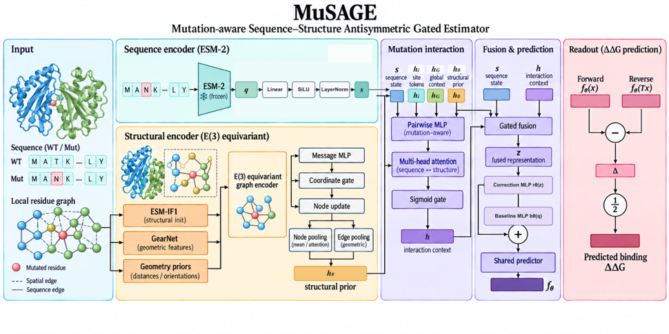

# MuSAGE

<p align="center">
  
</p>

MuSAGE predicts mutation-associated changes in protein–protein binding affinity from sequence and structure inputs.

## Getting started

### Requirements

- Python 3.10
- PyTorch 2.x; CUDA 12.1 is recommended for GPU training
- NumPy, SciPy, scikit-learn, fair-esm
- TorchDrug 0.2.1 for GearNet-Edge feature generation

### Installation

```bash
git clone https://github.com/philjphuang1227-rgb/MuSAGE.git
cd MuSAGE
conda env create -f environment.yml
conda activate musage
pip install -e .
```

## Datasets

Training data, SKEMPI subsets, fixed split files, and external-validation inputs are included under [`datasets/`](datasets/README.md). The included tables and structures are ready to use; their checksums and data sources are listed in the dataset guide.

To stage the released SKEMPI sample table and fold assignments for the feature/training scripts:

```bash
bash run_scripts/prepare_skempicl_features.sh
```

The feature-generation commands then build graph and pretrained sequence/structure features locally. The staging script does not download or redistribute upstream pretrained model weights. See [data provenance](docs/DATA_PROVENANCE.md) and [reproduction steps](docs/REPRODUCIBILITY.md).

## Training and evaluation

After generating the feature caches in [the reproduction guide](docs/REPRODUCIBILITY.md), run the five-seed, ten-fold SKEMPI complex-level training protocol:

```bash
bash run_scripts/train_skempicl_10fold.sh
```

Aggregate fold-matched out-of-fold predictions for the five seeds:

```bash
bash run_scripts/aggregate_skempicl_oof.sh
```

External validation inputs and scoring notes are in [`validation/`](validation/README.md). The external sets are frozen evaluation sets and were not used for training or model selection.

## Reproduce by training

This release provides source code, datasets, fixed fold assignments, training configuration, and the architecture figure. Trained MuSAGE weights and raw experiment outputs are not distributed. Follow [the reproduction guide](docs/REPRODUCIBILITY.md) to generate features, train the models, and calculate evaluation metrics locally.

Training writes each fold's `model.pt` and `predictions.csv`, together with seed-level `metrics.json`, under `outputs/SKEMPI_CL/`. These files are generated on your computer and are excluded from Git. The guide specifies five training seeds and ten complex-level folds, plus the commands for aggregating held-out predictions.

## Architecture

The author-provided architecture figure is included unchanged at [assets/musage_architecture.png](assets/musage_architecture.png). See [architecture notes](docs/ARCHITECTURE.md) and [reproduction steps](docs/REPRODUCIBILITY.md) for model inputs and training details.

## License

A project license has not been selected. Dataset and upstream model terms remain those of their respective sources.

